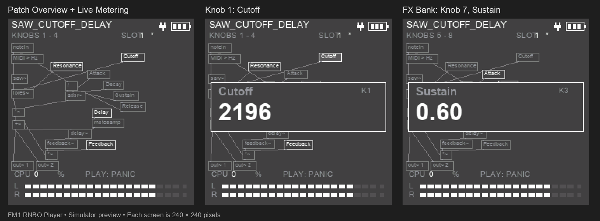

# fm1-rnbo

Run compiled RNBO instruments on the M-VAVE FM1, with a permanent player and
three stored patch slots. Upload a new instrument without reinstalling firmware.



The player provides eight parameter controls, MIDI and keyboard input, stereo
output meters, a battery indicator, saved controls and a patch overview derived
from the original RNBO layout. Turning a knob shows the parameter name and its
actual value for 1.5 seconds, then returns to the overview.

## Controls

| Control | Action |
| --- | --- |
| K1–K4 | Adjust the current bank's four parameters |
| FX | Switch between parameters 1–4 and 5–8 |
| PRESETS | Cycle occupied patch slots |
| SAVE | Save this slot's controls/octave and select it for startup |
| Octave buttons | Transpose the keyboard |
| PLAY | Panic / silence the instrument |
| MASTER | Output volume |

The battery icon uses three coarse voltage-based bars. A plug indicates USB
host power; it does not indicate charging or estimate remaining runtime.

## Build environment

The tested workflow uses macOS, Apple's command-line development tools, Python
3.12 or newer, Node.js, Docker Desktop and a local installation of **RNBO 1.4.4**.
The RNBO exporter is intentionally pinned to that version's internal APIs.
Set `RNBO_DIR` if RNBO is outside the usual Max application/package locations.
Arial is rasterized from the Mac's installed fonts during the local build.

```sh
git clone https://github.com/little-scale/fm1-rnbo.git
cd fm1-rnbo
bash Setup.command
```

Setup installs the Python dependencies and retrieves the pinned SDK packaging
files and JieLi compiler. It does not install anything on the FM1. Start Docker
Desktop before compiling native firmware. The platform source is vendored;
there are no Git submodules to initialize. See [UPSTREAM.md](UPSTREAM.md).

## First install

With the FM1 connected by USB, run:

```sh
bash fm1-base/rnbo-loader/Build-and-Install-Visual-Player.command
```

This checkpoints existing local builds, builds and validates the player and
saw patch, checks host audio, asks before installing firmware, then uploads the
saw patch to **slot 1**. It stops on failure. Firmware installation uses the
upstream installer's normal confirmation; do not unplug while it writes.

Build only, without installing:

```sh
source setup/env.sh
python3 fm1-base/rnbo-loader/tools/build.py --player-only
python3 fm1-base/rnbo-loader/tools/build.py --patch saw_cutoff_delay
```

The player and patches have separate builds. The player package is
`fm1-base/rnbo-loader/build/rnbo-player.fwsc`; modules are
`fm1-base/rnbo-loader/modules/NAME/build/NAME.rnbom`.

## Build and upload your own patch

Save the patch from inside the RNBO editor as a standalone `.rnbopat`, rather
than saving only its surrounding Max patch. Use a filename starting with a
letter and containing at most 24 letters, digits, underscores or hyphens.

```sh
bash fm1-base/rnbo-loader/Open-Build-Uploader.command
```

Open the local uploader in Chrome or Edge, connect to the FM1, choose a slot,
select the `.rnbopat`, choose Mono / 2 voices / 4 voices, then **Build & Upload**.
Keep the launcher's Terminal window open. The service runs on localhost;
compilation uses the local RNBO installation and Docker. Web MIDI handles USB
transfer. **Build Only** works without a connected FM1. Already compiled
`.rnbom` files can also be uploaded directly.

The command-line equivalent, from this repository root:

```sh
source setup/env.sh
python3 fm1-base/rnbo-loader/tools/build.py --patch /absolute/path/my_patch.rnbopat
python3 fm1-base/rnbo-loader/tools/upload.py fm1-base/rnbo-loader/modules/my_patch/build/my_patch.rnbom --slot 1
python3 fm1-base/rnbo-loader/tools/upload.py --slots
```

An upload replaces the chosen logical slot. PRESETS selects stored instruments;
one instrument runs at a time. SAVE remembers each slot's controls separately.
Unsaved control changes are discarded when changing slots.

## Patch conventions and limits

- Use `notein` for pitch/velocity MIDI events and `out~ 1` / `out~ 2` for stereo
  output. The player forwards its keyboard and incoming MIDI to the patch.
- Parameters follow RNBO's exported parameter indices. Use `@displayorder`
  to establish the intended order and `@displayname` for readable labels, then
  check the generated parameter description. The first eight map to the knobs.
  `@unit` supplies popup units; numeric values use RNBO's own conversion.
- The adapter allows up to 16 exported controls, with the first eight exposed
  by the current UI. Audio input patches are not supported by this revision.
- Mono, two-voice and four-voice builds are supported. FM4Echo demonstrates
  voice stealing with one shared master effect, rather than duplicating the
  delay for each voice. The browser recognizes this embedded voice group.
- Self-contained patches are supported. Embedded Gen graphs and GenExpr are supported within the documented
  [Gen limits](fm1-base/rnbo-loader/GEN-SUPPORT.md). External abstractions,
  sample files and external Gen dependencies require additional integration.
- Native code, data and optional layout metadata share a **64 KiB image**
  budget; module state has **176 KiB**. Builds reject exceeded limits.
- Layouts retain object arrangement and cords, shorten labels and separate
  overlapping boxes. Embedded subpatches remain boxes. Layouts beyond 96
  objects / 384 wire segments, or too dense to fit, use the parameter list.
  Old modules without metadata also retain the list and percentage popup.

## Included instruments

| Source in `fm1-base/rnbo-loader/patches/` | Instrument |
| --- | --- |
| `saw_cutoff_delay.rnbopat` | Saw, resonant filter, ADSR and feedback echo; eight controls |
| `fm4echo.rnbopat` | Four-voice FM with voice stealing and shared stereo echo |
| `fm8poly2fast.rnbopat` | Optimized two-voice FM |
| `fm8poly2.rnbopat` | Earlier two-voice reference |
| `fm8.rnbopat` | Eight-control mono FM |
| `fm.rnbopat` | Four-control FM |
| `mono.rnbopat` | Basic sine instrument |

Max wrappers under `modules/NAME/NAME.maxpat` allow opening the examples in
Max. Build from the `.rnbopat` source after making edits. `fm1-base/rnbo/`
contains the shared adapter/exporter and the original standalone prototype;
`fm1-base/rnbo-loader/` is the current permanent player.

## Playable test collection

The [15-patch test guide](fm1-base/rnbo-loader/hardware-tests/README.md)
includes standalone RNBO sources, editable Max wrappers, eight mapped controls,
listening checks and a hardware results sheet. Load one group into the three
slots at a time; the FM1 runs one selected patch.

| Group | Slot 1 | Slot 2 | Slot 3 |
| --- | --- | --- | --- |
| 1 — RNBO fundamentals | Keyboard synth | Clock/glide sequencer | 64-step list |
| 2 — Gen synthesis | Constants oscillator | History feedback filter | Nested Gen/codebox |
| 3 — Gen memory | Sample-and-hold | Stereo data table | Dual-tap delay |
| 4 — Effects | Comb/allpass | Lo-fi/averages | Gen maths/routing |
| 5 — Polyphony | Two-voice FM | Four-voice FM/echo | Four-voice Gen hybrid |

From the repository root, build and then upload a group (replace `1` with `1`–`5`):

```sh
bash fm1-base/rnbo-loader/Build-Test-Group-1.command
bash fm1-base/rnbo-loader/Upload-Test-Group-1.command --check
bash fm1-base/rnbo-loader/Upload-Test-Group-1.command
```

Builds do not install firmware or upload patches. Uploads verify source hashes,
settings and native package reviews before replacing slots 1–3. The guide records
hardware observations separately from the archived host results, including
T08’s subtle Mix control and T14’s intentionally attenuated high-feedback echo.
The deferred echo gain revision is not included.

## Validation

Check all 15 source/configuration pairs, editable Max graph topology, archived
host hashes and five upload-bank mappings without RNBO or hardware:

```sh
python3 fm1-base/rnbo-loader/hardware-tests/check_sources.py
```

Run the complete compiler-dependent suite on the supported Mac environment:

```sh
source setup/env.sh
python3 fm1-base/rnbo-loader/tools/verify.py
```

The local suite checks audio, polyphony, voice sleep, echo feedback, knob banks,
meters, parameter popups, battery ADC ownership, storage/recovery, module
validation, browser flow and 32-bit portability. It requires the local RNBO
package and Mac fonts, but does not upload firmware. Browser transfer is mocked
in these tests; successful local tests do not prove hardware timing.

The visual player and saw patch were built for the native target, installed and
activated in slot 1 on 29 October 2026. The FM1 reported 2% CPU and zero xruns at
that status reading; this is not a worst-case CPU figure. The owner confirmed
the result. See [docs/validation.md](docs/validation.md) for provenance and
remaining hardware checks. Browser Web MIDI transfer remains separately
unverified on the device.

## Licensing

Original integration code and patch designs remain **MIT**, except files with
their own notices. The battery adapter retains **GPL-3.0-or-later**, so the
combined player containing it is distributed under GPL-3.0-or-later. Vendored
platform files retain MPL-2.0 and their other notices. RNBO-generated code and
runtime retain their own terms when produced locally.

See [LICENSING.md](LICENSING.md) and [LICENSE](LICENSE). SDK/compiler downloads,
the installed RNBO package, generated exports, private device logs, system
fonts and prebuilt firmware are not bundled in this source repository.
